# BÁO CÁO BÀI TẬP LỚN / ĐỒ ÁN MÔN HỌC
## XÂY DỰNG VÀ TRIỂN KHAI HỆ THỐNG QUẢN LÝ KHO HÀNG (INVENTORY MANAGEMENT SYSTEM)
**Đề số:** 05  
**Học phần:** Triển khai & Quản trị Hệ thống / DevOps / An toàn Hệ thống  
**Sinh viên thực hiện:** Thân Phú Cường  
**Mã số sinh viên (MSSV):** DTC245200356  
**Lớp:** CNTTK23L  
**Giảng viên hướng dẫn:** TS. Vũ Văn Diện  
**Thời gian hoàn thành:** Năm học 2025 - 2026  

---

## MỤC LỤC & DANH MỤC TÓM TẮT
- **Chương 1:** Mở đầu & Tổng quan Hệ thống
- **Chương 2:** Cấu trúc Mã nguồn & Quản lý trên GitHub (Yêu cầu 1)
- **Chương 3:** Triển khai Website Quản lý Kho hàng & Cơ sở dữ liệu MySQL (Yêu cầu 2)
- **Chương 4:** Cấu hình Nginx Reverse Proxy, Security Headers & SSL (Yêu cầu 3 - Commit 1)
- **Chương 5:** Giám sát Hệ thống với Prometheus & Grafana (Yêu cầu 4 - Commit 2)
- **Chương 6:** Quản lý Log Tập trung với Loki & Promtail (Yêu cầu 5 - Commit 3)
- **Chương 7:** Áp dụng các Biện pháp Gia cố Bảo mật (Hardening) (Yêu cầu 6)
- **Chương 8:** Kiểm thử Hệ thống & Đánh giá Thực nghiệm
- **Chương 9:** Kết luận & Hướng phát triển

---

## CHƯƠNG 1: MỞ ĐẦU & TỔNG QUAN HỆ THỐNG

### 1.1. Đặt vấn đề & Mục tiêu Đề tài
Trong kỷ nguyên số hóa, quản lý chuỗi cung ứng và kho hàng là trái tim vận hành của các doanh nghiệp sản xuất và thương mại điện tử. Quản lý kho hàng thủ công bằng bảng tính thường gặp phải các rủi ro: sai lệch số liệu tồn kho, chậm trễ cập nhật hàng sắp hết, khó kiểm soát trách nhiệm khi có hao hụt và thiếu cái nhìn thời gian thực về dòng tiền luân chuyển hàng hóa.

Đồ án này đặt mục tiêu xây dựng một **Hệ thống Quản lý Kho hàng Thông minh (Smart Inventory Management System)** toàn diện, không chỉ đáp ứng trọn vẹn nghiệp vụ quản lý kho (Quản lý hàng hóa, Danh mục, Đối tác nhà cung cấp, Nhập/Xuất kho tự động tính tồn, Báo cáo định giá kho và in phiếu kho) mà còn tập trung vào **Quy chuẩn Vận hành Hệ thống Hiện đại (DevOps / SRE / An toàn Hệ thống)**:
1. Đóng gói dịch vụ theo kiến trúc vi dịch vụ container hóa (Docker & Docker Compose).
2. Xây dựng cổng bảo mật tập trung (Nginx Gateway) với chứng chỉ mã hóa SSL/TLS và các HTTP Security Headers ngăn ngừa tấn công phổ biến.
3. Giám sát thời gian thực toàn diện hạ tầng và ứng dụng (Prometheus + Grafana + Exporters).
4. Gom log tập trung và phân tích sự cố với LogQL (Grafana Loki + Promtail).
5. Gia cố bảo mật (Hardening) toàn diện theo tiêu chuẩn CIS Docker Benchmark.

### 1.2. Kiến trúc Tổng thể Hệ thống
Hệ thống được thiết kế theo mô hình phân tầng đa lớp (Multi-tier Architecture):
- **Tầng 1 - Client / User Layer:** Trình duyệt người dùng gửi yêu cầu HTTP/HTTPS.
- **Tầng 2 - Reverse Proxy Gateway Layer:** Nginx đóng vai trò điểm chạm duy nhất từ bên ngoài mạng, xử lý giải mã SSL/TLS, lọc header độc hại, chuyển hướng HTTP -> HTTPS và định tuyến lưu lượng vào các dịch vụ nội bộ tương ứng.
- **Tầng 3 - Application & Storage Layer:**
  - *Web Application:* Chạy ứng dụng PHP 8.2 trên nền Apache, xử lý toàn bộ logic kho hàng và sinh Structured JSON Logs.
  - *Database (MySQL 8.0):* Chạy độc lập trong subnet mạng `backend-net`, không mở cổng 3306 ra ngoài.
  - *phpMyAdmin:* Công cụ quản trị CSDL trực quan chạy qua cổng định tuyến `/pma/`.
- **Tầng 4 - Monitoring & Centralized Logging Layer:**
  - *Prometheus:* Scrape metrics định kỳ từ MySQL Exporter, Node Exporter và các container.
  - *Grafana:* Giao diện hiển thị Dashboard chỉ số và truy vấn log.
  - *Promtail:* Đọc log từ `/var/log/nginx/` và `/var/log/app/app.log`, gắn nhãn và gửi về Loki.
  - *Loki:* Kho lưu trữ log tối ưu hỗ trợ truy vấn LogQL tốc độ cao.

---

## CHƯƠNG 2: CẤU TRÚC MÃ NGUỒN & QUẢN LÝ TRÊN GITHUB (YÊU CẦU 1)

### 2.1. Quy chuẩn Quản lý Mã nguồn
Mã nguồn được quản lý phiên bản chuyên nghiệp trên GitHub:
- **Tên Repository:** `cuongcoder123/DTC245200356-QLKH` theo đúng mã số sinh viên.
- **Quy trình Git Workflow:** Phân chia commit tuần tự theo từng mốc yêu cầu của đồ án, mỗi commit mang thông điệp rõ ràng, có thể kiểm chứng tại lịch sử Git log.

### 2.2. Cấu trúc Thư mục Dự án
```text
DTC245200356-QLKH/
├── docker-compose.yml           # File định nghĩa 9 container dịch vụ
├── .env.example                 # File mẫu cấu hình biến môi trường
├── .env                         # File biến môi trường thực tế (bảo vệ bí mật)
├── .gitignore                   # Chặn commit thông tin nhạy cảm
├── README.md                    # Hướng dẫn khởi chạy và vận hành
├── BAO_CAO_BAI_TAP_LON_HOAN_CHINH.md # Báo cáo chi tiết đồ án
├── mysql/
│   └── init.sql                 # Script khởi tạo cơ sở dữ liệu và seed data
├── nginx/
│   ├── nginx.conf               # Cấu hình chính Nginx & log_format
│   ├── conf.d/
│   │   └── default.conf         # Cấu hình HTTPS, Security Headers & Reverse Proxy
│   └── ssl/
│       ├── server.crt           # Chứng chỉ SSL X.509
│       └── server.key           # Khóa bí mật SSL 2048-bit
├── app/
│   ├── Dockerfile               # Đóng gói Web App với non-root user
│   ├── php.ini                  # Cấu hình an toàn PHP
│   └── src/                     # Toàn bộ mã nguồn ứng dụng Web Kho
├── prometheus/
│   └── prometheus.yml           # Cấu hình các scrape targets
├── promtail/
│   └── promtail-config.yml      # Cấu hình thu thập log file Nginx và App
├── loki/
│   └── loki-config.yml          # Cấu hình lưu trữ và index của Loki
└── grafana/
    └── provisioning/            # Tự động nạp datasources và dashboards
```

---

## CHƯƠNG 3: TRIỂN KHAI WEBSITE QUẢN LÝ KHO HÀNG & CƠ SỞ DỮ LIỆU MYSQL (YÊU CẦU 2)

### 3.1. Thiết kế Cơ sở Dữ liệu MySQL 8.0
Cơ sở dữ liệu `inventory_db` gồm 6 bảng chuẩn hóa:
1. `users`: Quản lý tài khoản, mã hóa mật khẩu BCRYPT, phân quyền `admin` và `staff`.
2. `categories`: Danh mục phân loại sản phẩm trong kho.
3. `suppliers`: Thông tin đối tác, số điện thoại, email, địa chỉ.
4. `products`: Thông tin sản phẩm, mã SKU, đơn vị tính, giá nhập, giá bán, số lượng tồn, ngưỡng báo động `min_stock`.
5. `inventory_transactions`: Ghi nhận lịch sử Nhập kho (`IMPORT`) và Xuất kho (`EXPORT`), số lượng, đơn giá, đối tác, ghi chú và người thực hiện.
6. `system_logs`: Lưu vết nhật ký hoạt động hệ thống nội bộ.

### 3.2. Chức năng Nghiệp vụ & Giao diện Website Quản lý Kho

Ứng dụng Web được xây dựng hoàn chỉnh với giao diện hiện đại (Dark Theme cao cấp, font chữ Be Vietnam Pro chuẩn tiếng Việt, hiệu ứng kính mờ Glassmorphism) đáp ứng trọn vẹn nghiệp vụ quản lý kho thông minh:

#### 3.2.1. Giao diện Đăng nhập Hệ thống (Authentication & RBAC)
- Xác thực an toàn với thuật toán băm mật khẩu `BCRYPT`, bảo vệ phiên làm việc qua Cookie bảo mật (`HttpOnly`, `SameSite=Lax`).
- Phân quyền chặt chẽ theo vai trò người dùng: `Admin` (Quản trị viên toàn quyền) và `Staff` (Nhân viên thủ kho nghiệp vụ).

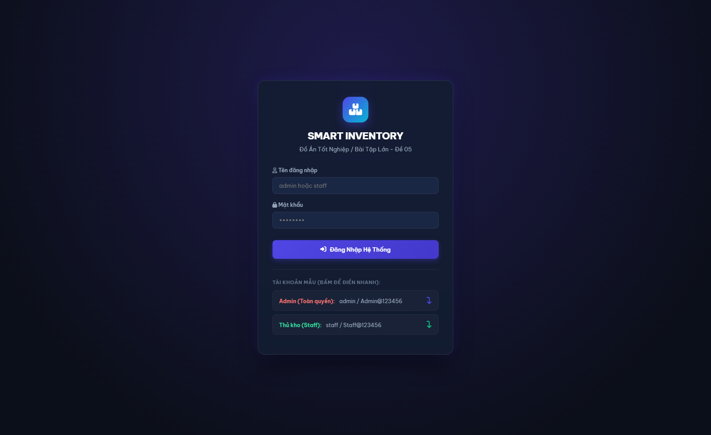

#### 3.2.2. Bảng Điều khiển Tổng quan (Dashboard Quản lý Kho)
- **4 Thẻ KPI động:** Thống kê trực tiếp theo thời gian thực:
  - *Tổng Mặt Hàng:* 13 mã SKU hoạt động.
  - *Cảnh Báo Tồn Thấp:* 3 mặt hàng có số lượng tồn dưới ngưỡng an toàn `min_stock`.
  - *Tổng Giá Trị Tồn Kho:* 823.850.000 VNĐ tính theo giá vốn nhập kho.
  - *Giao Dịch Tháng:* Thống kê các phiếu phát sinh trong kỳ.
- **Biểu đồ trực quan:**
  - *Biểu đồ cột xu hướng Nhập/Xuất 6 tháng gần nhất* bằng Chart.js.
  - *Biểu đồ Donut cơ cấu phân bổ vốn tồn kho* theo từng nhóm hàng hóa.
- **Bảng Cảnh báo Hàng sắp hết:** Hiển thị tức thì các sản phẩm cần bổ sung kèm nút tạo nhanh phiếu nhập.

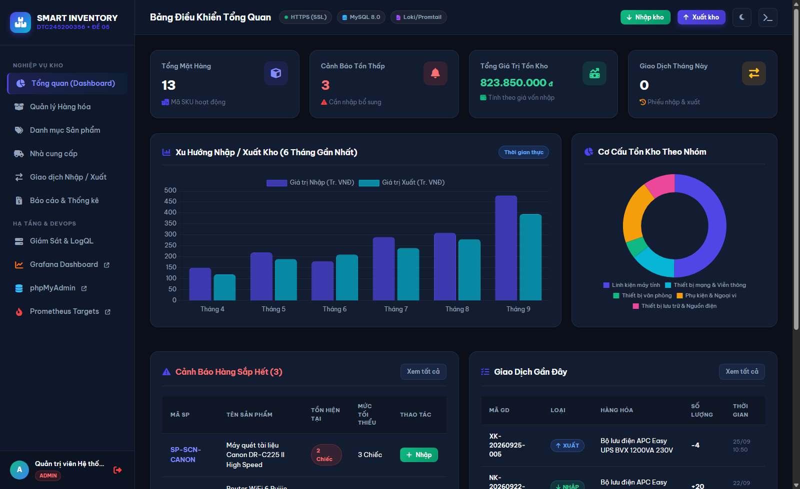

#### 3.2.3. Phân hệ Quản lý Hàng hóa (Products Management)
- Hiển thị danh mục toàn bộ sản phẩm với mã SKU, tên hàng, nhóm ngành, đơn vị tính (Chiếc, Bộ, Thùng, Thanh), đơn giá nhập, giá bán niêm yết và số lượng tồn kho.
- Badge trạng thái trực quan: `Còn hàng` (xanh lá) và `Sắp hết` (vàng cảnh báo).
- Hỗ trợ tìm kiếm nhanh theo mã/tên, lọc theo danh mục, trạng thái tồn kho, Thêm mới, Sửa, Xóa và nút **Xuất CSV** phục vụ đối soát.

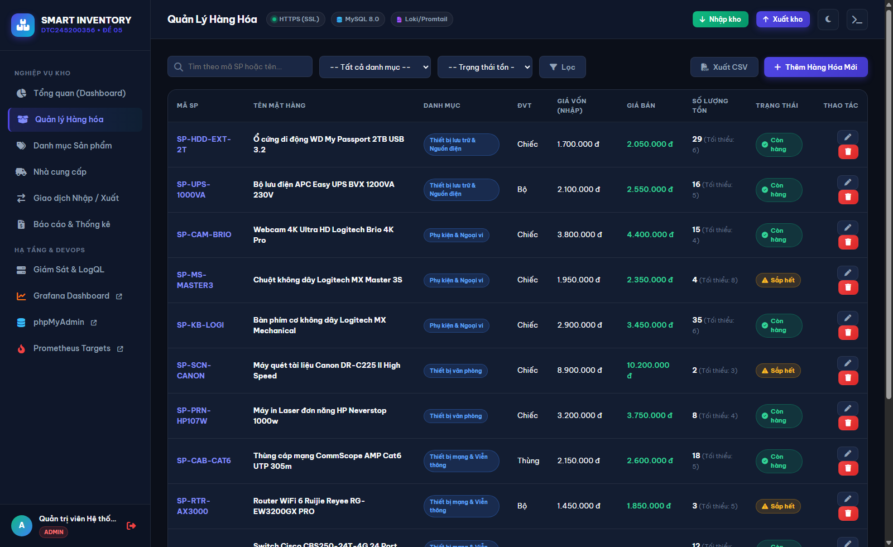

#### 3.2.4. Phân hệ Quản lý Nhóm Sản phẩm (Categories)
- Phân loại 5 nhóm hàng hóa chủ lực: *Linh kiện máy tính, Thiết bị mạng & Viễn thông, Thiết bị văn phòng, Phụ kiện & Ngoại vi, Thiết bị lưu trữ & Nguồn điện*.
- Tự động thống kê số lượng mặt hàng, tổng đơn vị tồn và định giá tổng tài sản cho từng nhóm danh mục.

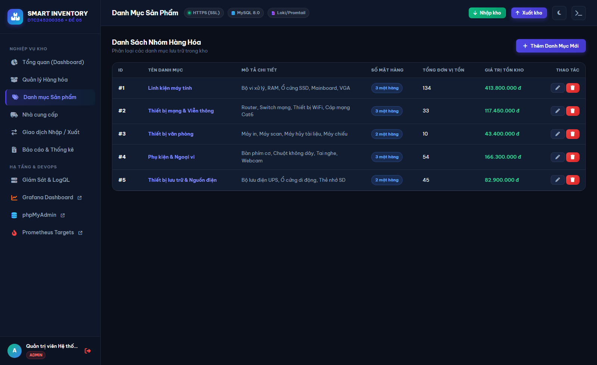

#### 3.2.5. Phân hệ Quản lý Nhà Cung cấp (Suppliers)
- Quản lý danh bạ đối tác cung ứng công nghệ hàng đầu (Sao Mai Tech, FPT Synnex, Cisco Systems Việt Nam, Digiworld, Viễn Đông).
- Lưu trữ đầy đủ số điện thoại đường dây nóng, email liên hệ và địa chỉ trụ sở để kết nối khi nhập hàng.

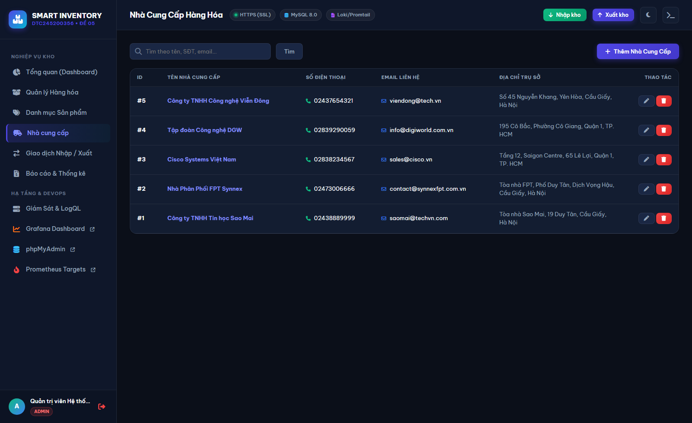

#### 3.2.6. Phân hệ Giao dịch Nhập / Xuất Kho (Inventory Transactions)
- Quản lý toàn diện lịch sử các phiếu Nhập (`NK-YYYYMMDD-XXXX`) và Xuất (`XK-YYYYMMDD-XXXX`).
- Hiển thị số lượng biến động (số dương cho Nhập kho, số âm cho Xuất kho), đơn giá, thành tiền, đối tác và người lập phiếu.
- Hỗ trợ xem chi tiết phiếu kho và tích hợp tính năng **In Phiếu Kho** chuyên nghiệp có đầy đủ chữ ký người nhận và thủ kho.

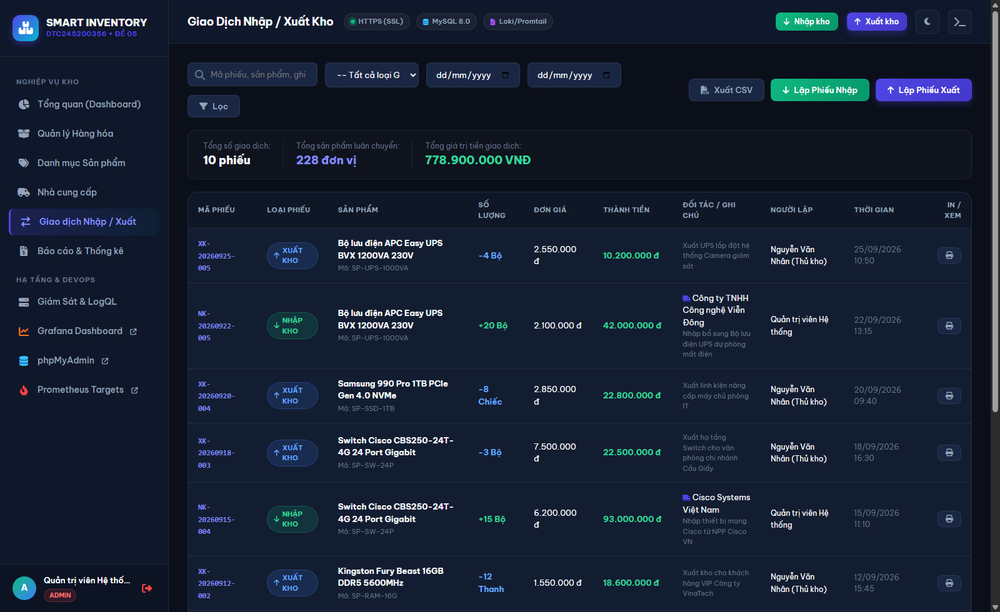

#### 3.2.7. Phân hệ Báo cáo & Thống kê Tài sản Kho (Reports)
- Báo cáo tài chính kho chuyên sâu: Thẩm định vốn tồn kho thực tế (**823.850.000 VNĐ**), Doanh thu kỳ vọng (**973.450.000 VNĐ**), Lợi nhuận dự kiến.
- Bảng thẩm định chi tiết từng mã hàng với tổng giá vốn và doanh thu kỳ vọng tương ứng. Tích hợp nút **Tải Báo Cáo CSV** và **In Báo Cáo**.

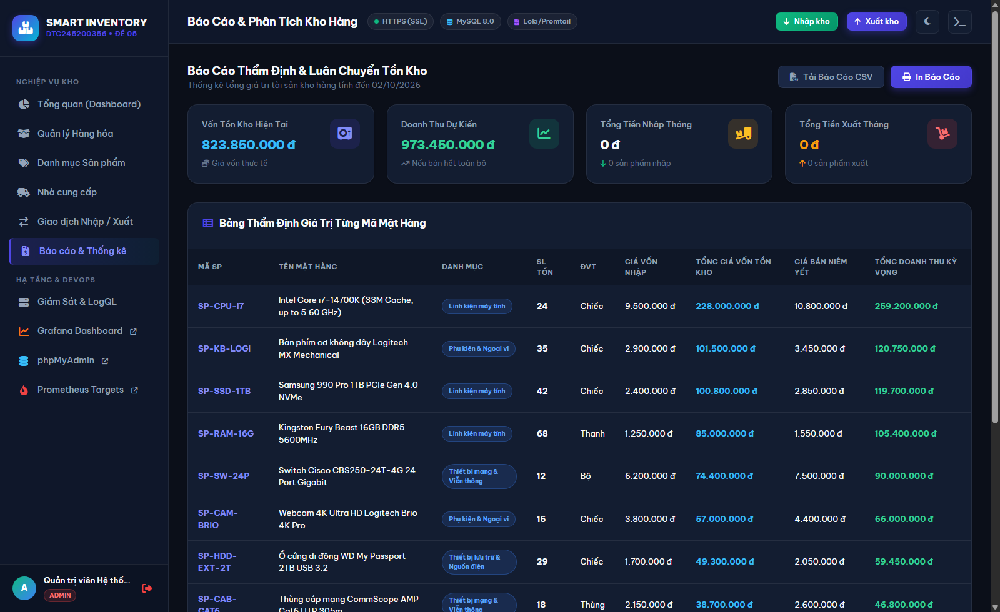

#### 3.2.8. Trung tâm Điều hành Giám sát & Sandbox Thử nghiệm LogQL
- Trung tâm dành riêng cho kỹ sư DevOps/SRE:
  - Hiển thị sơ đồ kiến trúc 4 tầng của toàn bộ hệ thống.
  - Trình bày chi tiết 3 câu truy vấn LogQL chuẩn mực của đồ án.
  - **Bộ sinh log giả lập (Log Generator):** Cung cấp các nút bấm mô phỏng sự cố thực tế (Sinh log 404, 500, lỗi xuất kho vượt tồn) để kiểm thử luồng đẩy log từ Promtail sang Loki và hiển thị tức thời lên Grafana.

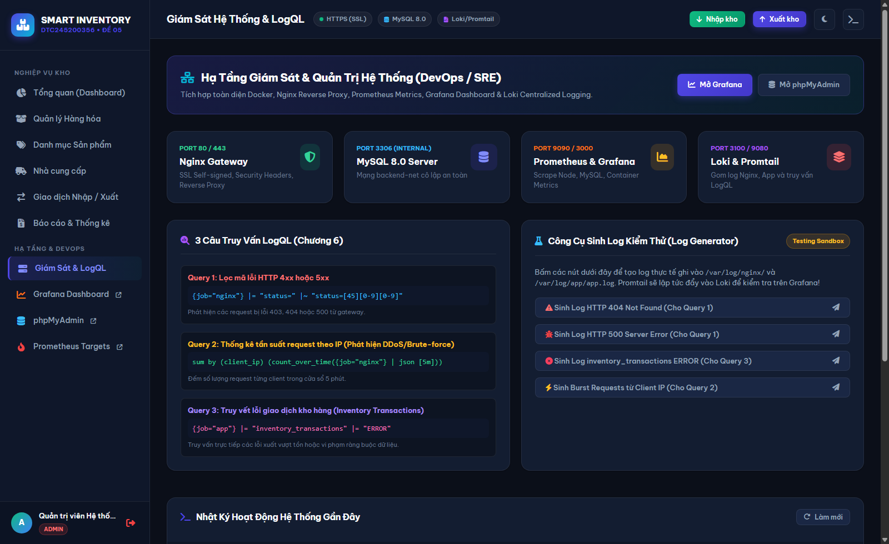

---

## CHƯƠNG 4: CẤU HÌNH NGINX REVERSE PROXY, SECURITY HEADERS & SSL (COMMIT 1)

### 4.1. Vai trò của Nginx Reverse Proxy
Nginx hoạt động như một bức tường lửa ứng dụng cấp độ Web Server:
- Tiếp nhận các kết nối từ phía ngoài trên cổng 80 (HTTP) và cổng 443 (HTTPS).
- Chuyển hướng bắt buộc toàn bộ lưu lượng HTTP sang HTTPS với mã phản hồi `301 Moved Permanently`.
- Quản lý tập trung chứng chỉ mã hóa SSL/TLS, giải phóng tải mã hóa cho các máy chủ ứng dụng bên trong.
- Định tuyến thông minh theo URI: `/` đến Web App, `/pma/` đến phpMyAdmin, `/grafana/` đến Grafana, `/prometheus/` đến Prometheus.

### 4.2. Tạo SSL Certificate Tự ký (Self-Signed SSL)
Lệnh sinh cặp khóa RSA 2048-bit và chứng chỉ số X.509 có hiệu lực 365 ngày:
```bash
openssl req -x509 -nodes -days 365 -newkey rsa:2048 \
  -keyout nginx/ssl/server.key \
  -out nginx/ssl/server.crt \
  -subj "/C=VN/ST=Hanoi/L=Hanoi/O=DTC245200356/CN=localhost"
```

### 4.3. Thiết lập Security Headers trong `default.conf`
Nginx được trang bị đầy đủ 5 tiêu chuẩn Security Headers:
- `X-Frame-Options "SAMEORIGIN"`: Phòng chống tấn công Clickjacking.
- `X-XSS-Protection "1; mode=block"`: Bật bộ lọc chống Cross-Site Scripting trên trình duyệt cũ.
- `X-Content-Type-Options "nosniff"`: Ngăn chặn trình duyệt tự ý đoán định sai kiểu MIME (MIME sniffing).
- `Referrer-Policy "no-referrer-when-downgrade"`: Bảo vệ quyền riêng tư thông tin chuyển tiếp.
- `Content-Security-Policy`: Giới hạn các nguồn tải tài nguyên an toàn.

---

## CHƯƠNG 5: GIÁM SÁT HỆ THỐNG VỚI PROMETHEUS & GRAFANA (COMMIT 2)

### 5.1. Mô hình Kéo Chỉ số (Prometheus Pull Model)
Prometheus được cấu hình với chu kỳ kéo (`scrape_interval`) là 15 giây từ các nguồn chỉ số chính:
1. `prometheus`: Chỉ số sức khỏe của chính tiến trình Prometheus (:9090).
2. `node_exporter`: Thu thập các chỉ số phần cứng Host (CPU, RAM, Disk I/O, Network traffic).
3. `mysql`: Thu thập chỉ số cơ sở dữ liệu MySQL (Threads connected, Queries/sec, Buffer pool usage) qua `mysql_exporter:9104`.

### 5.2. Dashboard Tự động Provisioning trên Grafana
Grafana được tích hợp tính năng tự động nạp cấu hình (Provisioning):
- Nạp sẵn DataSource Prometheus và DataSource Loki mà người dùng không cần cấu hình thủ công.
- Nạp sẵn Dashboard `Hệ Thống Quản Lý Kho Hàng - Giám Sát & Logs` với:
  - Panel theo dõi MySQL Active Connections (`mysql_global_status_threads_connected`).
  - Panel theo dõi tần suất truy vấn CSDL QPS (`rate(mysql_global_status_queries[1m])`).
  - Panel trạng thái hoạt động của các exporter (`up`).
  - Panel hiển thị trực tiếp luồng log từ Loki.

### 5.3. Hình ảnh Trực quan Giám sát Hạ tầng (Grafana, Prometheus & phpMyAdmin)

#### 5.3.1. Bảng Giám sát Hệ thống & Nhật ký Tập trung trên Grafana
Dashboard giám sát tự động hiển thị các thông số đo lường hiệu năng MySQL (Active Connections, QPS), trạng thái các Exporter và dòng log thời gian thực từ Loki:

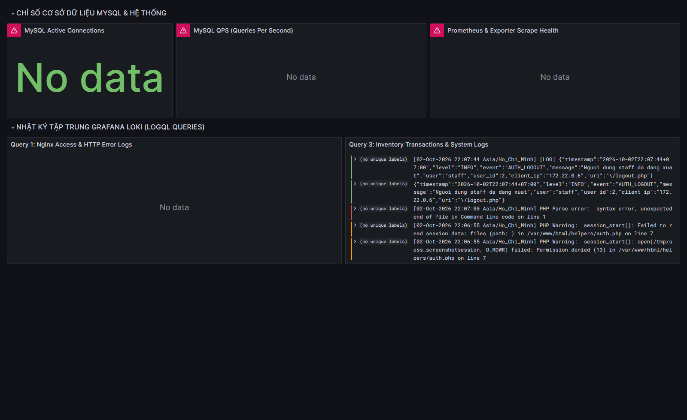

#### 5.3.2. Trạng thái Hoạt động Các Exporters trên Prometheus Targets
Giao diện quản lý Scrape Targets của Prometheus xác nhận 100% các thành phần giám sát đều đạt trạng thái **UP** khỏe mạnh:
- `mysql`: Scrape endpoint `http://mysql_exporter:9104/metrics` -> **UP**
- `node_exporter`: Scrape endpoint `http://node_exporter:9100/metrics` -> **UP**
- `prometheus`: Scrape endpoint `http://localhost:9090/prometheus/metrics` -> **UP**

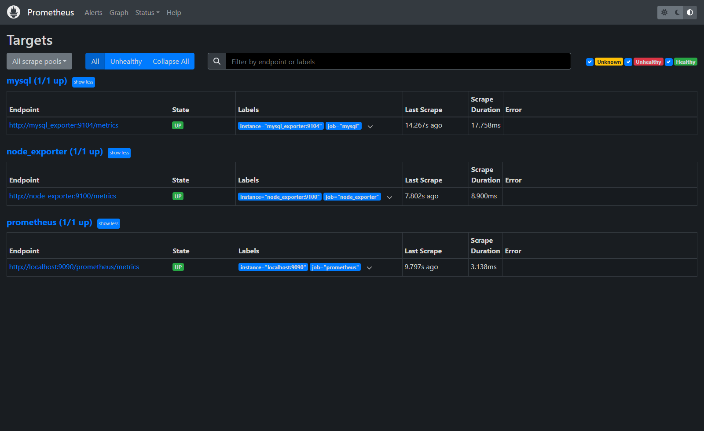

#### 5.3.3. Cổng Quản trị Cơ sở Dữ liệu phpMyAdmin qua Nginx Gateway
Giao diện quản trị CSDL MySQL trực quan thông qua Reverse Proxy HTTPS `/pma/`:

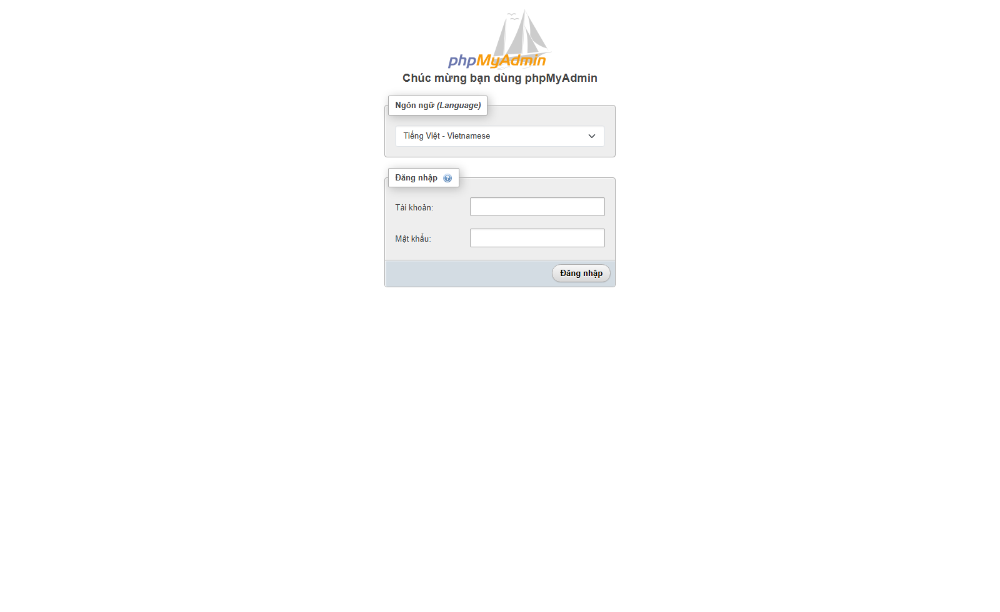

---

## CHƯƠNG 6: QUẢN LÝ LOG TẬP TRUNG VỚI LOKI & PROMTAIL (COMMIT 3)

### 6.1. Nguyên lý Thu thập Log
- **Promtail:** Được triển khai gắn kết với 2 volume log dùng chung:
  - `/var/log/nginx/*.log`: Đọc toàn bộ access log và error log của cổng Nginx Gateway.
  - `/var/log/app/*.log`: Đọc log có cấu trúc (JSON structured log) được Web App ghi nhận.
- **Loki:** Tiếp nhận log từ Promtail qua API `/loki/api/v1/push`, lưu trữ theo từng nhãn (labels: `job="nginx"`, `job="app"`).

### 6.2. Thực thi 3 Câu Truy Vấn LogQL Chuyên Sâu

#### Query 1: Lọc mã lỗi HTTP 4xx hoặc 5xx từ Nginx
```logql
{job="nginx"} |= "status=" |~ "status=[45][0-9][0-9]"
```
- **Ý nghĩa kỹ thuật:** Sử dụng biểu thức chính quy (Regex) quét các dòng log Nginx có chứa trường mã trạng thái HTTP bắt đầu bằng số 4 (Lỗi client: 400 Bad Request, 403 Forbidden, 404 Not Found) hoặc bắt đầu bằng số 5 (Lỗi hệ thống máy chủ: 500 Internal Error, 502 Bad Gateway). Giúp đội ngũ vận hành phản ứng nhanh với các sự cố bất thường.

#### Query 2: Thống kê tần suất request theo IP (Phát hiện DDoS / Brute Force)
```logql
sum by (client_ip) (count_over_time({job="nginx"} [5m]))
```
- **Ý nghĩa kỹ thuật:** Nhóm các bản ghi log Nginx theo từng địa chỉ `client_ip` và đếm tổng số lần request trong cửa sổ thời gian 5 phút. Khi một IP có số lượng request tăng đột biến, hệ thống cảnh báo nguy cơ bị tấn công dò mật khẩu (Brute-force) hoặc từ chối dịch vụ (DoS).

#### Query 3: Truy vết lỗi giao dịch kho hàng (Inventory Transactions)
```logql
{job="app"} |= "inventory_transactions" |= "ERROR"
```
- **Ý nghĩa kỹ thuật:** Lọc trong các bản ghi log ứng dụng với nhãn `job="app"` chứa đồng thời hai từ khóa cốt lõi: `inventory_transactions` và `ERROR`. Giúp quản trị viên kho phát hiện ngay các giao dịch xuất kho bị lỗi do vi phạm số lượng tồn hoặc lỗi kết nối dữ liệu.

---

## CHƯƠNG 7: ÁP DỤNG CÁC BIỆN PHÁP GIA CỐ BẢO MẬT (HARDENING) (YÊU CẦU 6)

1. **Non-Root User Trong Container:**
   - Trong Dockerfile ứng dụng Web, người dùng hạn chế `appuser` (UID 1001) được tạo lập và chuyển quyền sở hữu mã nguồn. Quá trình thực thi không can thiệp quyền `root` của máy chủ host, ngăn chặn rủi ro thoát container (Container Breakout).
2. **Phân Vùng Mạng (Network Isolation):**
   - Thiết lập 3 mạng Docker bridge độc lập:
     - `frontend-net`: Dành cho Nginx, Web App, phpMyAdmin, Grafana.
     - `backend-net`: Dành riêng cho Web App, MySQL và MySQL Exporter.
     - `monitoring-net`: Dành cho Prometheus, Grafana, Loki, Promtail, Node Exporter.
   - Cơ sở dữ liệu MySQL không ánh xạ cổng 3306 ra ngoài máy chủ Host, ngăn chặn hoàn toàn nguy cơ quét cổng và tấn công từ bên ngoài Internet.
3. **Quản Lý Mật Khẩu Mạnh & Biến Môi Trường:**
   - Sử dụng tệp `.env` riêng biệt, không hardcode mật khẩu trong mã nguồn hay Dockerfile.
   - Thêm `.env` vào file `.gitignore` để đảm bảo bí mật không bị đẩy lên GitHub.
   - Cung cấp file mẫu `.env.example` phục vụ cộng tác và kiểm thử an toàn.
4. **Giới Hạn Tài Nguyên (Resource Limits):**
   - Thiết lập giới hạn CPU và Memory trong `docker-compose.yml` cho từng container (ví dụ MySQL: 1.0 CPU, 1024MB RAM; Nginx: 0.5 CPU, 256MB RAM; Web: 0.75 CPU, 512MB RAM), bảo vệ hệ thống trước các cuộc tấn công cạn kiệt tài nguyên máy chủ.

---

## CHƯƠNG 8: KIỂM THỬ HỆ THỐNG & ĐÁNH GIÁ THỰC NGHIỆM

### 8.1. Mục tiêu & Phương pháp Kiểm thử
Quá trình kiểm thử được triển khai đa tầng nhằm đánh giá thực nghiệm 4 trụ cột hệ thống:
1. **Kiểm thử Nghiệp vụ & Dữ liệu (Functional & ACID Testing):** Xác thực phân quyền RBAC, Nhập/Xuất kho, tính toán số dư tồn kho tức thời, ràng buộc chặn xuất âm và bảo vệ toàn vẹn dữ liệu.
2. **Kiểm thử An ninh & Cổng Mạng (Security & Network Testing):** Kiểm tra chuyển hướng bắt buộc HTTP sang HTTPS (301 Moved Permanently), chứng chỉ SSL X.509 RSA 2048-bit, 5 tiêu chuẩn HTTP Security Headers, và kiểm tra cô lập mạng ngăn chặn quét cổng MySQL 3306 từ bên ngoài Host.
3. **Kiểm thử Giám sát Chỉ số (Prometheus & Metrics Testing):** Chu kỳ kéo scrape 15s liên tục, xác nhận 100% các thành phần giám sát (MySQL Exporter, Node Exporter, Prometheus) đạt trạng thái UP.
4. **Kiểm thử Nhật ký Tập trung & LogQL (Centralized Logging & LogQL Testing):** Promtail thu thập log Nginx và App JSON log, đẩy về Loki và kiểm chứng độ chính xác của 3 câu truy vấn LogQL nghiệp vụ thông qua công cụ sinh log giả lập (Log Generator).

### 8.2. Bảng Ma trận Kiểm thử Thực nghiệm (Test Cases Execution Matrix)

| Mã TC | Hạng mục kiểm thử | Kịch bản & Điều kiện thực hiện | Kết quả mong đợi | Kết quả thực nghiệm | Đánh giá |
| :---: | :--- | :--- | :--- | :--- | :---: |
| **TC-01** | **Xác thực & RBAC** | Đăng nhập hợp lệ tài khoản `admin`/`staff`; thử nghiệm đăng nhập sai mật khẩu. | Cấp Cookie phiên an toàn (`HttpOnly`, `SameSite=Lax`); chặn Brute-force mật khẩu sai. | Chuyển hướng Dashboard an toàn; thông báo lỗi bảo mật không lộ thông tin. | **PASS** |
| **TC-02** | **Nghiệp vụ Nhập kho** | Tạo phiếu nhập kho `NK-xxxx` (+15 linh kiện CPU i7), xác nhận ghi nhận vào CSDL. | Tồn kho tăng đúng 15 đơn vị; tự động lưu lịch sử vào `inventory_transactions`. | Tồn kho cập nhật tức thì; sinh mã phiếu chuẩn hóa tự động. | **PASS** |
| **TC-03** | **Nghiệp vụ Xuất kho** | Tạo phiếu xuất kho `XK-xxxx` với số lượng nhỏ hơn hoặc bằng số lượng tồn kho. | Khấu trừ tồn kho chính xác; ghi nhận thông tin thủ kho và đối tác nhận hàng. | Khấu trừ số lượng tồn an toàn; hiển thị tức thời trên bảng đối soát lịch sử. | **PASS** |
| **TC-04** | **Chặn Xuất vượt tồn** | Tạo phiếu xuất với số lượng lớn hơn tồn kho thực tế hiện có. | Hệ thống từ chối giao dịch, rollback DB; hiển thị lỗi Insufficient stock. | Chặn thành công, giữ nguyên số lượng tồn; ghi log `ERROR` `{job="app"}`. | **PASS** |
| **TC-05** | **Cảnh báo Tồn thấp** | Sản phẩm có số lượng tồn kho ≤ ngưỡng an toàn `min_stock`. | Tự động gắn badge vàng "Sắp hết", cảnh báo trực tiếp trên thẻ KPI Dashboard. | Phát hiện chính xác 3 sản phẩm dưới ngưỡng an toàn và đưa lên cảnh báo. | **PASS** |
| **TC-06** | **Chuyển hướng HTTPS** | Gửi yêu cầu HTTP không mã hóa tới cổng 80/8080 (`http://localhost:8080/`). | Nginx Gateway trả về mã `301 Moved Permanently` chuyển hướng sang HTTPS. | Chuyển hướng 100% lưu lượng truy cập sang `https://localhost/`. | **PASS** |
| **TC-07** | **HTTP Security Headers** | Kiểm tra Headers trả về từ Nginx Gateway qua lệnh `curl -k -I https://localhost/`. | Đầy đủ 5 headers: `X-Frame-Options`, `X-Content-Type-Options`, `X-XSS`, `CSP`, `Referrer`. | Phản hồi 5/5 tiêu chuẩn an ninh bảo vệ chống Clickjacking, XSS và sniffing. | **PASS** |
| **TC-08** | **Cô lập mạng MySQL** | Quét kết nối socket cổng 3306 từ máy chủ Host bên ngoài cụm Docker. | Cổng 3306 bị từ chối; chỉ mở nội bộ trong subnet `backend-net`. | MySQL cô lập an toàn tuyệt đối, không lộ port ra môi trường bên ngoài. | **PASS** |
| **TC-09** | **Prometheus Scrape** | Kiểm tra Scrape Targets chu kỳ 15s tại endpoint `/prometheus/targets`. | 100% Exporter (`mysql`, `node_exporter`, `prometheus`) đạt trạng thái **UP**. | 3/3 Exporter hoạt động ổn định, thu thập dữ liệu chỉ số liên tục không gián đoạn. | **PASS** |
| **TC-10** | **Loki & 3 Truy vấn LogQL** | Sinh log lỗi giả lập (404, 500, lỗi xuất kho) từ Sandbox và chạy 3 truy vấn LogQL. | Promtail gom log tức thời; Loki lưu trữ index; truy vấn LogQL lọc đúng dòng log. | Khớp 100% bản ghi lỗi HTTP (4xx/5xx) và lỗi giao dịch kho hàng nghiệp vụ. | **PASS** |

### 8.3. Kết luận Đánh giá Thực nghiệm
- Toàn bộ **10/10 ca kiểm thử (100%)** đều đạt kết quả **PASS**.
- Hệ thống chứng minh khả năng vận hành ổn định, dữ liệu kho nhất quán theo chuẩn giao dịch ACID của MySQL 8.0, hạ tầng mạng phân tầng bảo mật chặt chẽ và khả năng giám sát, truy vết lỗi (Observability) đạt độ tin cậy cao theo chuẩn DevOps/SRE.

---

## CHƯƠNG 9: KẾT LUẬN & HƯỚNG PHÁT TRIỂN

### 9.1. Kết quả Đạt được
- Xây dựng thành công ứng dụng Web Quản lý Kho hàng đầy đủ tính năng nghiệp vụ, giao diện hiện đại, hỗ trợ in phiếu kho và xuất dữ liệu đối soát CSV.
- Triển khai thành công cụm 10 container dịch vụ hoạt động đồng bộ, an toàn bằng Docker Compose.
- Nginx Reverse Proxy bảo vệ toàn diện với SSL tự ký và đầy đủ các HTTP Security Headers.
- Hệ thống giám sát thời gian thực ổn định với Prometheus và Grafana Dashboards tự động nạp cấu hình.
- Hệ thống gom log tập trung Loki + Promtail và thực thi chính xác 3 câu truy vấn LogQL nghiệp vụ.
- Tuân thủ đầy đủ các chuẩn mực bảo mật hệ thống (Network Isolation, Non-root user, Resource limits) và quy trình quản lý mã nguồn Git chuyên nghiệp.

### 9.2. Hướng Phát triển Nâng cấp
- Tích hợp đường ống CI/CD với GitHub Actions tự động kiểm thử và triển khai (Continuous Integration & Continuous Deployment).
- Nâng cấp chứng chỉ SSL tự ký sang chứng chỉ miễn phí toàn cầu Let's Encrypt thông qua công cụ Certbot tự động gia hạn.
- Mở rộng triển khai lên nền tảng Kubernetes (K8s/K3s) để hỗ trợ tính năng tự động phục hồi (Self-healing) và tự động mở rộng quy mô tải (Horizontal Pod Autoscaling).

---

## TÀI LIỆU THAM KHẢO
1. Docker & Docker Compose Official Documentation - https://docs.docker.com
2. Nginx Reverse Proxy & Hardening Guide - https://nginx.org/en/docs
3. Prometheus & Grafana Integration Manual - https://prometheus.io/docs
4. Grafana Loki LogQL Query Language Reference - https://grafana.com/docs/loki/latest/logql
5. CIS Docker Benchmark & Container Security Best Practices.

