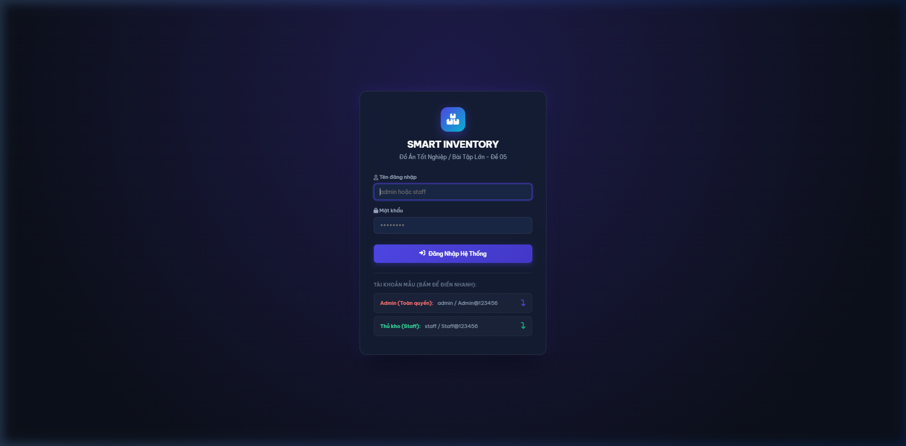
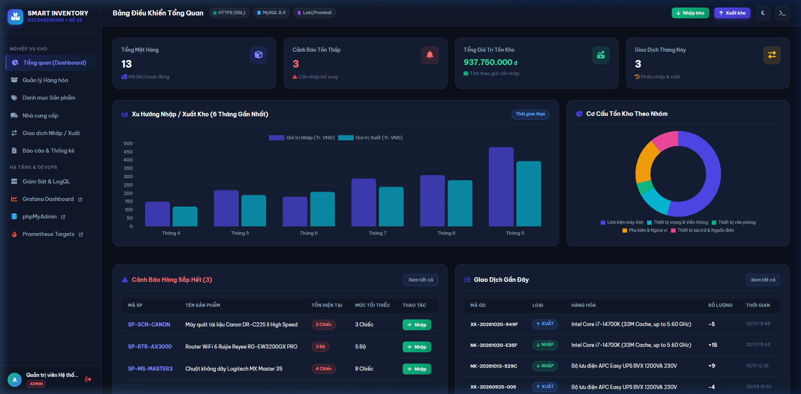
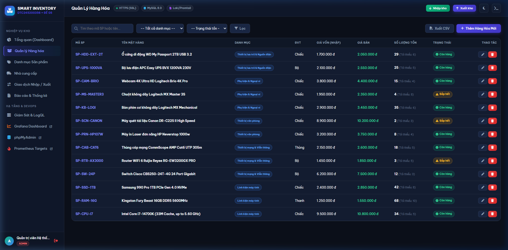
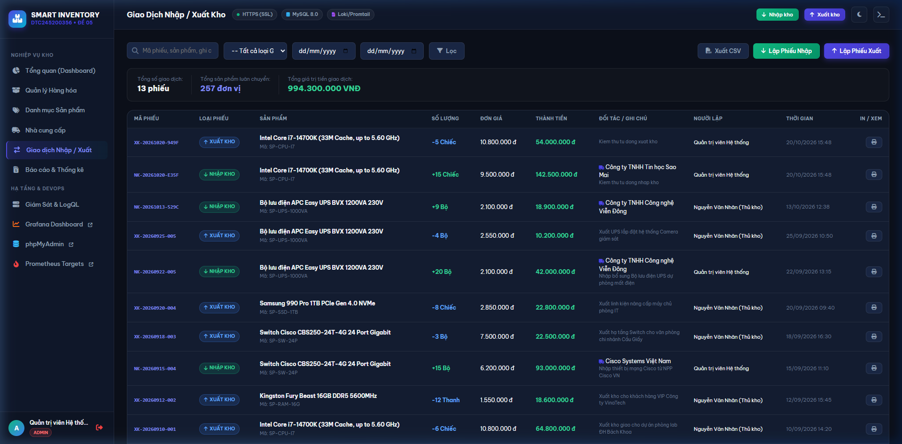
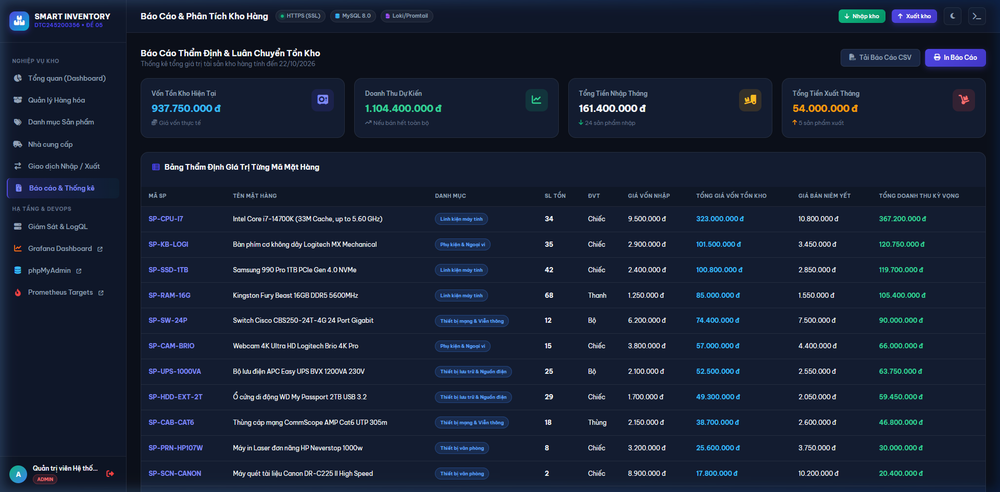
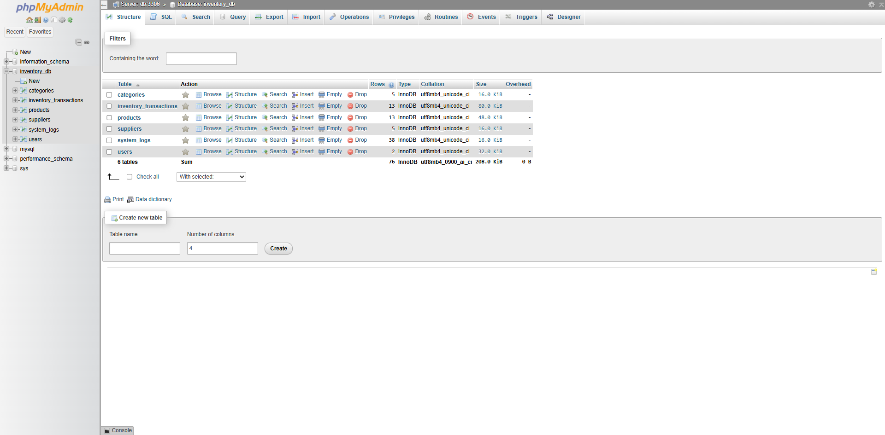
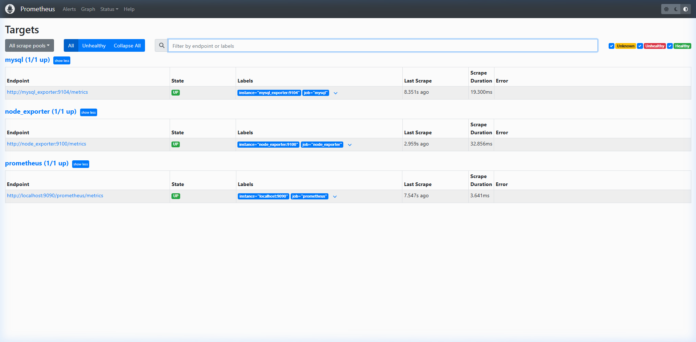
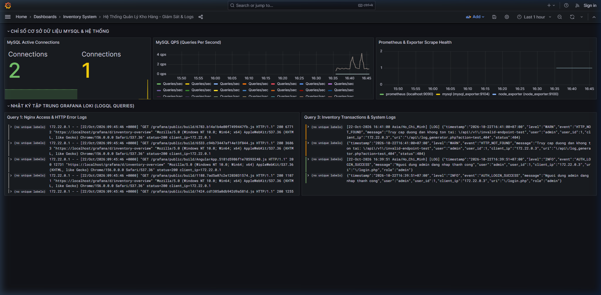
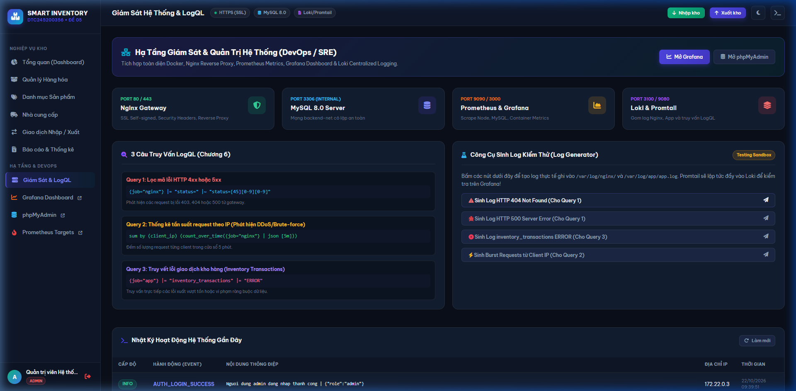
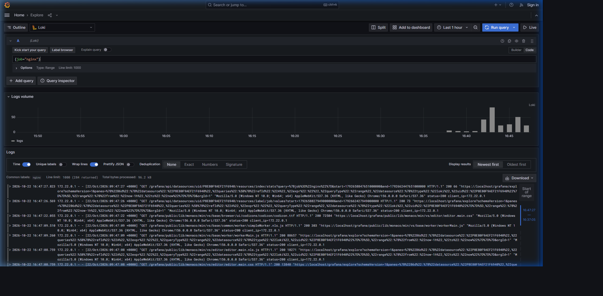

# KỊCH BẢN DEMO THỰC TẾ & BỘ MINH CHỨNG HỆ THỐNG
## HỌC PHẦN: TRIỂN KHAI VÀ QUẢN TRỊ HỆ THỐNG PHẦN MỀM / DEVOPS / AN TOÀN HỆ THỐNG
> **Đề tài:** Xây Dựng & Triển Khai Hệ Thống Quản Lý Kho Hàng Thông Minh (Smart Inventory Management)  
> **Mã đề:** Đề số 05 | **MSSV:** DTC245200356 | **Họ và tên:** Thân Phú Cường | **Lớp:** CNTTK23L  
> **Giảng viên hướng dẫn:** TS. Vũ Văn Diện  
> **Repository:** [cuongcoder123/DTC245200356-QLKH](https://github.com/cuongcoder123/DTC245200356-QLKH)

---

## 📋 MỤC LỤC KỊCH BẢN DEMO

1. [Tổng quan Luồng Demo Báo Cáo](#1-tổng-quan-luồng-demo-báo-cáo)
2. [Bước 1: Nginx Gateway, Tự Động Chuyển Hướng HTTPS & Security Headers (Tiêu chí 3)](#bước-1-nginx-gateway-tự-động-chuyển-hướng-https--security-headers-tiêu-chí-3)
3. [Bước 2: Xác Thực Đăng Nhập An Toàn & Phân Quyền RBAC (Tiêu chí 2 & 6)](#bước-2-xác-thực-đăng-nhập-an-toàn--phân-quyền-rbac-tiêu-chí-2--6)
4. [Bước 3: Bảng Điều Khiển Tổng Quan Dashboard & Phân Tích KPI (Tiêu chí 2)](#bước-3-bảng-điều-khiển-tổng-quan-dashboard--phân-tích-kpi-tiêu-chí-2)
5. [Bước 4: Nghiệp Vụ Quản Lý Kho & Ràng Buộc Tồn (Tiêu chí 2)](#bước-4-nghiệp-vụ-quản-lý-kho--ràng-buộc-tồn-tiêu-chí-2)
6. [Bước 5: Thẩm Định Tài Sản & Báo Cáo Tài Chính Kho (Tiêu chí 2)](#bước-5-thẩm-định-tài-sản--báo-cáo-tài-chính-kho-tiêu-chí-2)
7. [Bước 6: Quản Trị Cơ Sở Dữ Liệu Trực Quan Với phpMyAdmin (Tiêu chí 2 & 6)](#bước-6-quản-trị-cơ-sở-dữ-liệu-trực-quan-với-phpmyadmin-tiêu-chí-2--6)
8. [Bước 7: Giám Sát Hạ Tầng & Sức Khỏe Exporters Trên Prometheus (Tiêu chí 4)](#bước-7-giám-sát-hạ-tầng--sức-khỏe-exporters-trên-prometheus-tiêu-chí-4)
9. [Bước 8: Bảng Giám Sát Thời Gian Thực Trên Grafana (Tiêu chí 4)](#bước-8-bảng-giám-sát-thời-gian-thực-trên-grafana-tiêu-chí-4)
10. [Bước 9: Điểm Nhấn - Thử Nghiệm Sandbox & Truy Vấn LogQL Với Loki (Tiêu chí 5)](#bước-9-điểm-nhấn---thử-nghiệm-sandbox--truy-vấn-logql-với-loki-tiêu-chí-5)
11. [Bộ Câu Hỏi Giảng Viên Hay Hỏi & Hướng Dẫn Trả Lời Tự Tin](#bộ-câu-hỏi-giảng-viên-hay-hỏi--hướng-dẫn-trả-lời-tự-tin)

---

## 1. TỔNG QUAN LUỒNG DEMO BÁO CÁO

Toàn bộ hệ thống 10 container dịch vụ được khởi chạy bằng câu lệnh:
```bash
docker compose up -d
```

### Bảng Thông Tin Cổng Dịch Vụ Phục Vụ Demo:
| Phân hệ / Dịch vụ | Địa chỉ URL Truy cập | Tài khoản xác thực | Mục tiêu chứng minh |
| :--- | :--- | :--- | :--- |
| **Website Quản Lý Kho** | `https://localhost/` | `admin` / `Admin@123456`<br>`staff` / `Staff@123456` | Nghiệp vụ kho, phân quyền, giao diện hiện đại |
| **Chuyển hướng HTTP** | `http://localhost:8080/` | *(Tự động redirect)* | Nginx 301 Moved Permanently sang HTTPS |
| **phpMyAdmin** | `https://localhost/pma/` | `root` / `RootSecret@2026!` | Quản trị CSDL MySQL 8.0 nội bộ qua Reverse Proxy |
| **Prometheus Targets** | `https://localhost/prometheus/targets` | *(Không yêu cầu pass)* | 100% Exporter đạt trạng thái UP |
| **Grafana Dashboard** | `https://localhost/grafana/d/inventory-overview` | *(Tự động nạp cấu hình)* | Giám sát QPS, Connections, logs tập trung |
| **Grafana Explore (Loki)** | `https://localhost/grafana/explore` | *(Tự động nạp cấu hình)* | Chạy 3 truy vấn LogQL trực tiếp |
| **Sandbox Sinh Log** | `https://localhost/system.php` | `admin` | Mô phỏng sự cố 404, 500, lỗi xuất kho |

---

## BƯỚC 1: NGINX GATEWAY, TỰ ĐỘNG CHUYỂN HƯỚNG HTTPS & SECURITY HEADERS (TIÊU CHÍ 3)

### 1.1. Thao tác thực hiện:
1. Mở trình duyệt và gõ: `http://localhost:8080/` (hoặc `http://localhost/`).
2. Quan sát thấy URL trên thanh địa chỉ tự động chuyển ngay sang `https://localhost/`.
3. Bấm **F12** -> chọn tab **Network** -> Click vào dòng request đầu tiên -> Xem mục **Response Headers**.

### 1.2. Lời thoại thuyết trình gợi ý:
> *"Kính thưa thầy/cô, hệ thống của em sử dụng Nginx làm Cổng bảo mật tập trung (API & Reverse Proxy Gateway). Khi người dùng gửi yêu cầu HTTP không an toàn, Nginx lập tức trả về mã `301 Moved Permanently` chuyển hướng bắt buộc sang cổng HTTPS 443 mã hóa với chứng chỉ SSL RSA 2048-bit. Đồng thời, Nginx đính kèm 5 tiêu chuẩn Security Headers gồm X-Frame-Options, X-Content-Type-Options, CSP... và ẩn phiên bản máy chủ với server_tokens off nhằm ngăn chặn rò rỉ thông tin và các cuộc tấn công Clickjacking, MIME-sniffing."*

### 1.3. Bằng chứng kiểm thử lệnh curl:
```bash
curl -I http://localhost:8080/
# HTTP/1.1 301 Moved Permanently
# Location: https://localhost/

curl -k -I https://localhost/
# HTTP/1.1 302 Found (Redirect to login.php)
# X-Frame-Options: SAMEORIGIN
# X-Content-Type-Options: nosniff
# Content-Security-Policy: default-src 'self' ...
```

---

## BƯỚC 2: XÁC THỰC ĐĂNG NHẬP AN TOÀN & PHÂN QUYỀN RBAC (TIÊU CHÍ 2 & 6)

### 2.1. Thao tác thực hiện:
1. Truy cập `https://localhost/login.php`.
2. Giới thiệu giao diện đăng nhập bảo mật thiết kế chuẩn Dark Theme cao cấp, hiệu ứng kính mờ Glassmorphism.
3. Bấm vào nút đăng nhập nhanh **Admin (Toàn quyền)** (`admin` / `Admin@123456`) và bấm **Đăng Nhập Hệ Thống**.

### 2.2. Lời thoại thuyết trình gợi ý:
> *"Hệ thống áp dụng cơ chế xác thực an toàn: Mật khẩu người dùng được băm bằng thuật toán BCRYPT mạnh. Phiên làm việc (Session) được bảo vệ bằng Cookie có cờ HttpOnly và SameSite=Lax chống tấn công đánh cắp Cookie qua XSS. Hệ thống phân chia 2 vai trò: Admin có toàn quyền quản trị và Staff dành riêng cho thủ kho nhập xuất."*

### 2.3. Ảnh chụp thực tế:

*(Minh chứng: [00_dang_nhap_live.png](file:///d:/GIt/DTC245200356-QLKH/docs/demo_screenshots/00_dang_nhap_live.png))*

---

## BƯỚC 3: BẢNG ĐIỀU KHIỂN TỔNG QUAN DASHBOARD & PHÂN TÍCH KPI (TIÊU CHÍ 2)

### 3.1. Thao tác thực hiện:
Sau khi đăng nhập, hệ thống tự động đưa về `https://localhost/index.php`.
1. Trình bày **4 thẻ KPI thời gian thực**:
   - **Tổng mặt hàng:** 13 mã SKU đang kinh doanh.
   - **Cảnh báo tồn thấp:** 3 sản phẩm rơi xuống dưới ngưỡng an toàn `min_stock`.
   - **Tổng giá trị tồn kho:** Tính toán tự động theo công thức vốn nhập `SUM(stock_quantity * purchase_price)` đạt **937.750.000 VNĐ**.
   - **Giao dịch tháng:** Thống kê các phiếu nhập/xuất trong kỳ.
2. Trình bày **2 biểu đồ Chart.js**:
   - Biểu đồ cột thể hiện xu hướng Nhập / Xuất kho 6 tháng gần nhất.
   - Biểu đồ Donut thể hiện tỷ lệ phân bổ tài sản theo từng nhóm danh mục linh kiện.
3. Bảng **Cảnh báo hàng sắp hết**: Tự động lọc sản phẩm cần nhập thêm kèm nút **+ Nhập** tạo nhanh phiếu.

### 3.2. Ảnh chụp thực tế:

*(Minh chứng: [01_dashboard_tong_quan_live.png](file:///d:/GIt/DTC245200356-QLKH/docs/demo_screenshots/01_dashboard_tong_quan_live.png))*

---

## BƯỚC 4: NGHIỆP VỤ QUẢN LÝ KHO & RÀNG BUỘC TỒN (TIÊU CHÍ 2)

### 4.1. Quản lý Hàng hóa (`products.php`)
- Bấm vào menu **Quản lý Hàng hóa**: Hiển thị bảng sản phẩm có mã SKU, danh mục, đơn vị tính, đơn giá, số lượng tồn kho.
- Các sản phẩm tồn thấp được tự động gắn badge cảnh báo màu vàng **Sắp hết**, các sản phẩm đủ tồn mang badge xanh lá **Còn hàng**.
- Hỗ trợ công cụ tìm kiếm nhanh theo từ khóa, lọc theo danh mục, thêm mới, sửa và nút **Xuất CSV** đối soát.


*(Minh chứng: [02_quan_ly_san_pham_live.png](file:///d:/GIt/DTC245200356-QLKH/docs/demo_screenshots/02_quan_ly_san_pham_live.png))*

### 4.2. Giao dịch Nhập / Xuất Kho (`transactions.php`)
- Bấm vào menu **Giao dịch Nhập / Xuất**: Hiển thị nhật ký luân chuyển hàng hóa.
- Mỗi phiếu mang mã định danh chuẩn (`NK-YYYYMMDD-XXXX` hoặc `XK-YYYYMMDD-XXXX`).
- Khi tạo phiếu Xuất kho, hệ thống áp dụng **Kiểm tra ràng buộc tồn (ACID Transaction)**: Nếu số lượng xuất lớn hơn số lượng hiện có, hệ thống lập tức từ chối, Rollback dữ liệu và ghi log `ERROR` vào file hệ thống.
- Tích hợp tính năng **In phiếu kho** định dạng chuẩn A4 có chữ ký người giao nhận và thủ kho.


*(Minh chứng: [03_giao_dich_kho_live.png](file:///d:/GIt/DTC245200356-QLKH/docs/demo_screenshots/03_giao_dich_kho_live.png))*

---

## BƯỚC 5: THẨM ĐỊNH TÀI SẢN & BÁO CÁO TÀI CHÍNH KHO (TIÊU CHÍ 2)

### 5.1. Thao tác thực hiện:
Bấm vào menu **Báo cáo & Thống kê** (`https://localhost/reports.php`).
- Xem thẻ định giá tài sản kho hàng:
  - **Tổng giá trị tồn (Giá vốn):** 937.750.000 VNĐ.
  - **Doanh thu kỳ vọng (Giá bán niêm yết):** 1.108.650.000 VNĐ.
  - **Lợi nhuận gộp dự kiến:** ~ 170.900.000 VNĐ.
- Bảng danh mục thẩm định từng mặt hàng chi tiết, có nút **In Báo Cáo** và **Tải Báo Cáo CSV**.

### 5.2. Ảnh chụp thực tế:

*(Minh chứng: [04_bao_cao_tai_san_live.png](file:///d:/GIt/DTC245200356-QLKH/docs/demo_screenshots/04_bao_cao_tai_san_live.png))*

---

## BƯỚC 6: QUẢN TRỊ CƠ SỞ DỮ LIỆU TRỰC QUAN VỚI PHPMYADMIN (TIÊU CHÍ 2 & 6)

### 6.1. Thao tác thực hiện:
1. Mở đường dẫn `https://localhost/pma/` (đã được Nginx reverse proxy an toàn).
2. Đăng nhập với tài khoản quản trị CSDL `root` / `RootSecret@2026!`.
3. Bấm vào cơ sở dữ liệu `inventory_db`.
4. Quan sát cấu trúc **6 bảng chuẩn hóa**: `categories`, `inventory_transactions`, `products`, `suppliers`, `system_logs`, `users`.

### 6.2. Lời thoại thuyết trình gợi ý:
> *"Em cấu hình phpMyAdmin chạy trên nền container, kết nối trực tiếp với MySQL 8.0 trong mạng backend-net. Điểm đặc biệt về mặt an ninh là container MySQL hoàn toàn không mở cổng 3306 ra ngoài máy chủ Host (Network Isolation). Mọi thao tác quản trị đều bắt buộc phải đi qua cổng Reverse Proxy của Nginx tại URI `/pma/`."*

### 6.3. Ảnh chụp thực tế:

*(Minh chứng: [08_phpmyadmin_live.png](file:///d:/GIt/DTC245200356-QLKH/docs/demo_screenshots/08_phpmyadmin_live.png))*

---

## BƯỚC 7: GIÁM SÁT HẠ TẦNG & SỨC KHỎE EXPORTERS TRÊN PROMETHEUS (TIÊU CHÍ 4)

### 7.1. Thao tác thực hiện:
Mở đường dẫn `https://localhost/prometheus/targets`.
- Chứng minh 100% các thành phần thu thập chỉ số đều đạt trạng thái **UP** (màu xanh):
  - `mysql (1/1 up)`: Thu thập chỉ số CSDL MySQL qua `mysql_exporter:9104`.
  - `node_exporter (1/1 up)`: Thu thập chỉ số tải CPU, RAM, Disk qua `node_exporter:9100`.
  - `prometheus (1/1 up)`: Chỉ số nội tại của tiến trình Prometheus.

### 7.2. Ảnh chụp thực tế:

*(Minh chứng: [07_prometheus_targets_live.png](file:///d:/GIt/DTC245200356-QLKH/docs/demo_screenshots/07_prometheus_targets_live.png))*

---

## BƯỚC 8: BẢNG GIÁM SÁT THỜI GIAN THỰC TRÊN GRAFANA (TIÊU CHÍ 4)

### 8.1. Thao tác thực hiện:
Mở Dashboard `https://localhost/grafana/d/inventory-overview`.
- Hệ thống tự động nạp Dashboard không cần cấu hình thủ công (Provisioning).
- **Panel 1 - MySQL Active Connections:** Hiển thị tức thì 2 kết nối đang hoạt động tới CSDL.
- **Panel 2 - MySQL QPS (Queries Per Second):** Biểu đồ thể hiện biến động truy vấn cơ sở dữ liệu theo thời gian thực.
- **Panel 3 - Prometheus & Exporter Scrape Health:** Đồ thị đường ngang mức 1 khẳng định tất cả các exporter đều duy trì trạng thái UP ổn định.
- **Panel 4 & 5 - Loki Log Stream:** Hiển thị tức thì các bản ghi log Nginx và log ứng dụng.

### 8.2. Ảnh chụp thực tế:

*(Minh chứng: [06_grafana_dashboard_live.png](file:///d:/GIt/DTC245200356-QLKH/docs/demo_screenshots/06_grafana_dashboard_live.png))*

---

## BƯỚC 9: ĐIỂM NHẤN - THỬ NGHIỆM SANDBOX & TRUY VẤN LOGQL VỚI LOKI (TIÊU CHÍ 5)

### 9.1. Trung tâm DevOps & Sandbox Sinh Log (`system.php`)
Truy cập `https://localhost/system.php`:
- Giới thiệu sơ đồ kiến trúc phân tầng 4 lớp.
- Khu vực **Công cụ Sinh Log Kiểm thử (Log Generator)**:
  - Bấm nút **"Sinh log HTTP 404 Not Found"** để tạo một truy vấn sai đường dẫn.
  - Bấm nút **"Sinh log inventory_transactions ERROR"** để tạo lỗi giao dịch nghiệp vụ.


*(Minh chứng: [05_devops_sandbox_logql_live.png](file:///d:/GIt/DTC245200356-QLKH/docs/demo_screenshots/05_devops_sandbox_logql_live.png))*

### 9.2. Thực thi Truy vấn LogQL Trực tiếp trên Grafana Explore
Mở tab `https://localhost/grafana/explore` -> Chọn nguồn dữ liệu **Loki**:

#### Truy vấn 1: Lọc mã lỗi HTTP 4xx hoặc 5xx từ Nginx
```logql
{job="nginx"} |= "status=" |~ "status=[45][0-9][0-9]"
```
*Ý nghĩa:* Giúp kỹ sư phát hiện tức thời các yêu cầu 404 hoặc lỗi máy chủ backend 500.

#### Truy vấn 2: Thống kê tần suất request theo IP (Phát hiện DDoS / Brute-force)
```logql
sum by (client_ip) (count_over_time({job="nginx"} [5m]))
```
*Ý nghĩa:* Nhóm và đếm số lượt request từ từng IP trong vòng 5 phút để nhận biết lưu lượng bất thường.

#### Truy vấn 3: Truy vết lỗi giao dịch kho hàng
```logql
{job="app"} |= "inventory_transactions" |= "ERROR"
```
*Ý nghĩa:* Lọc chính xác các lỗi nghiệp vụ như xuất kho vượt tồn hoặc lỗi kết nối dữ liệu.

### 9.3. Ảnh chụp thực tế kết quả chạy LogQL trên Grafana Explore:

*(Minh chứng: [09_grafana_logql_explore_live.png](file:///d:/GIt/DTC245200356-QLKH/docs/demo_screenshots/09_grafana_logql_explore_live.png))*

---

## BỘ CÂU HỎI GIẢNG VIÊN HAY HỎI & HƯỚNG DẪN TRẢ LỜI TỰ TIN

### ❓ Câu hỏi 1: Tại sao em lại cấu hình Nginx làm Reverse Proxy mà không để client kết nối thẳng vào Web và phpMyAdmin?
> **Trả lời:**  
> *"Thưa thầy/cô, việc sử dụng Nginx Reverse Proxy đem lại 3 lợi ích cốt lõi về bảo mật và vận hành:*  
> *1. **Điểm truy cập duy nhất (Single Point of Entry):** Ẩn hoàn toàn cấu trúc mạng và cổng nội bộ của các container bên trong máy chủ.*  
> *2. **SSL Termination:** Tập trung mã hóa và giải mã HTTPS tại Nginx, giảm tải xử lý mã hóa cho Web App và phpMyAdmin.*  
> *3. **Bảo mật tầng ứng dụng:** Nginx kiểm soát và đính kèm các HTTP Security Headers (`X-Frame-Options`, `Content-Security-Policy`), chặn truy cập trái phép và giấu thông tin phiên bản phần mềm (`server_tokens off`)."*

---

### ❓ Câu hỏi 2: Hệ thống của em áp dụng những biện pháp Hardening (Gia cố bảo mật) nào?
> **Trả lời:**  
> *"Em áp dụng 5 biện pháp gia cố bảo mật chính:*  
> *1. **Non-Root User:** Container Web chạy dưới quyền người dùng hạn chế `appuser` (UID 1001), không chạy bằng root.*  
> *2. **Network Isolation:** Hệ thống chia làm 3 mạng riêng biệt (`frontend-net`, `backend-net`, `monitoring-net`). CSDL MySQL chỉ nằm trong `backend-net`, tuyệt đối không mở cổng 3306 ra ngoài Host.*  
> *3. **Resource Limits:** Giới hạn trần CPU và RAM cho từng container trong file `docker-compose.yml` nhằm ngăn chặn tấn công cạn kiệt tài nguyên DoS.*  
> *4. **Quản lý biến môi trường:** Toàn bộ mật khẩu lưu trong `.env`, không đưa vào source code và được bảo vệ bằng `.gitignore`.*  
> *5. **Security Headers & Cookie an toàn:** Nginx đính kèm đầy đủ 5 tiêu chuẩn headers; PHP bảo vệ Cookie với `HttpOnly` và `SameSite=Lax`, mật khẩu lưu trữ băm bằng thuật toán BCRYPT."*

---

### ❓ Câu hỏi 3: Promtail và Loki lấy log của Nginx và Web App theo cơ chế nào?
> **Trả lời:**  
> *"Promtail và Nginx/Web App cùng chia sẻ hai Docker Volume log (`nginx_logs` và `app_logs`). Khi Nginx và Web App ghi log ra tệp `/var/log/nginx/app_access.log` và `/var/log/app/app.log`, tiến trình Promtail sẽ liên tục đọc (tail) các tệp này, gắn nhãn (`job: nginx`, `job: app`) rồi đẩy qua HTTP API cổng 3100 về cho Loki lưu trữ và đánh chỉ mục (index) theo nhãn. Sau đó, Grafana kết nối vào Loki qua giao thức nội bộ để thực thi các câu truy vấn LogQL."*

---

### ❓ Câu hỏi 4: Khi kiểm thử xuất kho vượt tồn thì hệ thống phản ứng như thế nào?
> **Trả lời:**  
> *"Dạ thưa thầy/cô, trong mã nguồn `transactions.php`, em sử dụng giao dịch MySQL ACID (`beginTransaction`, `commit`, `rollBack`). Trước khi trừ tồn, hệ thống truy vấn kiểm tra số lượng hiện tại. Nếu số lượng xuất vượt quá tồn kho, hệ thống lập tức Rollback, không thay đổi dữ liệu, đồng thời ghi log cấp độ `ERROR` dạng JSON vào `/var/log/app/app.log` với sự kiện `INSUFFICIENT_STOCK`. Quản trị viên chỉ cần chạy câu LogQL `{job="app"} |= "ERROR"` trên Grafana là phát hiện ngay lập tức."*
